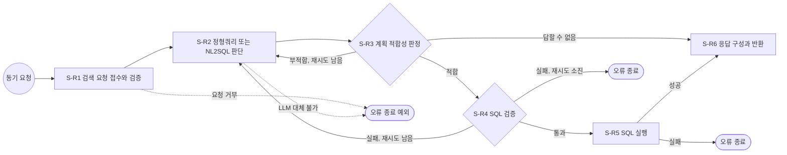

# SQL 검색기 워크플로우 설계서 (PPT 스크립트)

- 문서 성격: PPT 슬라이드 단위 스크립트. 슬라이드마다 패턴(A ~ E), 리드문, 본문, 도형 배치를 적음  
- 근거: `references/design-workflow-connector.md`(표 항목, 계산식, ID 규칙), `references/pptx-guide.md`(PPT 형식),  
  `references/prompt-guide.md`(LLM 시스템 프롬프트 섹션), `work/db_catalog.json`(DB 구조), `work/decisions.json`(설계 결정)  
- 작성: 지식니(지식, 데이터 엔지니어). 점검: 플로니 관점(단계 흐름, 시간 예산), 커넥니 관점(커넥터 명세)  
- 작성일: 2026-10-15  
- 표기 약속: "설계 가정"은 근거 문서나 실측이 없는 수치이며, 개발 후 실측으로 확인할 항목임

---

## 슬라이드 1. 제목 장표

- 패턴: 제목 장표(가이드 예외, `내용_단쪽` 레이아웃 사용)  
- 제목 개체 틀: SQL 검색기 워크플로우 설계서  
- 본문  
  - 워크플로우: `W-1` SQL 검색기  
  - 부제: 상담사 질문을 정해 둔 조회(정형쿼리) 또는 LLM이 만든 SQL(NL2SQL)로 바꿔, 회원 범위 안에서만 안전하게 답을 찾음  
  - 팀명: design-agentic-ai  
  - 작성일: 2026-10-15  
- 도형: 가운데 왼쪽 정렬 큰 글자 부제 + 아래쪽 틴트 박스에 워크플로우ID, 팀명, 작성일을 3칸으로 나란히 둠

---

## 슬라이드 2. 설계 개요

- 패턴: A(2단 헤더 바)  
- 리드문: 정형 DB에서 답을 찾는 동기 요청 1건을 15초 안에 끝내는 워크플로우를 설계함  
- 왼쪽 헤더 바 「설계 대상과 범위」  
  - 설계 대상: SQL 검색기 워크플로우 `W-1`(단계 6개, 반복 구간 1개, 커넥터 1개)  
  - 관련 유저스토리: 없음  
  - 시작 트리거: 동기 요청(호출자가 검색을 요청하고 응답을 기다림) → 단계ID 접두어 `S-R`  
  - 설계 범위: 요청 검증, 정형쿼리 또는 NL2SQL 판단, 계획 판정, SQL 검증, SQL 실행, 응답 반환  
  - 제외 범위: 답변 문장 생성(호출자 몫), 비정형 문서 검색(RAG), DB 스키마와 뷰 변경  
- 오른쪽 헤더 바 「설계 기준」(강조)  
  - DB 취급: 시스템 내부 구성요소. 외부시스템 연동 명세와 커넥터 목록에 넣지 않음  
  - 전체 시간 예산: 15초(종료 처리 시간 1초)  
  - 필드 표기 방식: `이름(타입, 필수 여부, 설명)`. 타입은 string, integer, boolean, date(YYYY-MM-DD), datetime, object, array  
  - DB 계정: NL2SQL 실행 계정 `sql_retriever_user`(관리자 권한 없음, 읽기 전용 세션)  
- 도형: 왼쪽 네이비 헤더 바 + 틴트 박스 목록, 오른쪽 블루 헤더 바 + 넘버 배지 4개 목록

---

## 슬라이드 3. 처음 보는 분을 위한 용어 풀이

- 패턴: D(데이터 테이블)  
- 리드문: 설계서에 자주 나오는 용어를 한 줄로 풀어 둠  
- 표(용어 | 한 줄 풀이)  
  - NL2SQL | 사람이 쓴 질문(Natural Language)을 LLM이 DB 조회 문장(SQL)으로 바꾸는 방식  
  - 정형쿼리 | 자주 묻는 질문에 쓰려고 미리 만들어 검사까지 끝낸 고정 SQL. ID로 골라 씀  
  - 뷰(View) | 원본 표를 그대로 보여 주지 않고, 필요한 컬럼과 기간만 골라 보여 주는 가상의 표  
  - 행 수준 보안(RLS) | DB가 행마다 "이 회원의 행인가"를 검사해, 지정한 회원의 행만 보이게 거르는 기능  
  - 세션 변수 | DB 접속 하나에만 잠시 붙여 두는 값. 여기서는 회원ID, 기준일, 거래 제공 시작일  
  - 최악값 | 타임아웃까지 기다리고 재시도까지 다 썼을 때 걸리는 가장 긴 시간  
  - 반복 구간 | 결과가 기준에 못 미칠 때 앞 단계로 되돌아가 다시 도는 구간  
  - 착지 단계 | 시간이 모자라거나 재시도를 다 썼을 때 이어서 가는 단계  
- 도형: 2열 표 1개(헤더행 `#E2EEF9`, 짝수행 `#F5F8FC`), 왼쪽 다크 배지 「용어」

---

## 슬라이드 4. 목차

- 패턴: E(목차, `내용_단쪽` 콘텐츠 슬라이드)  
- 리드문: 설계 가이드의 작성 순서 ① ~ ⑥을 따라 구성함  
- 본문(번호 + 하위 항목, 3열)  
  - 1열: ① 단계 도출 및 순서 정의(단계 목록, 흐름 도식, Mermaid) / ② 단계별 명세(S-R1 ~ S-R6)  
  - 2열: ③ 외부시스템 연동 명세 / ④ 반복 구간 명세 / ⑤ 워크플로우 명세  
  - 3열: 커넥터 설계(목록, LLM 명세, 프롬프트, 응답 구조) / ⑥ 남은 시간 예산 정책 / 부록  
- 도형: 열마다 넘버 배지와 틴트 카드

<!-- 간지: ① 단계 도출 및 순서 정의 -->

---

## 슬라이드 5. ① 단계 목록과 흐름 유형

- 패턴: D(데이터 테이블 + 오른쪽 판단 이유)  
- 리드문: 입력 워크플로우 6단계를 그대로 쓰고, 검증 실패 시 되돌아가는 반복 구간 1개를 둠  
- 왼쪽 표(단계ID | 단계명 | 담당자 유형 | 흐름)  
  - S-R1 | 검색 요청 접수와 검증 | 규칙기반 코드 | 순차  
  - S-R2 | 정형쿼리 또는 NL2SQL 판단 | 생성형AI + 규칙기반 코드 | 순차(반복 구간 시작)  
  - S-R3 | 계획 적합성 판정 | 규칙기반 코드 | 분기(적합, 부적합, 답할 수 없음)  
  - S-R4 | SQL 검증 | 규칙기반 코드 | 분기(통과, 재생성, 오류 종료)  
  - S-R5 | SQL 실행 | 규칙기반 코드 | 순차(실패 시 오류 종료)  
  - S-R6 | 응답 구성과 반환 | 규칙기반 코드 | 합류(S-R5, S-R3)  
- 오른쪽 틴트 박스 「흐름 유형 판단 이유」  
  1. 순차: 앞 단계 출력이 뒤 단계 입력이라 차례대로 이어짐  
  2. 분기: S-R3은 계획이 맞는지, S-R4는 SQL이 규칙을 지키는지에 따라 경로가 하나로 갈림  
  3. 반복: 부적합 또는 검증 실패면 사유를 붙여 S-R2로 1회 되돌아감(사용자 결정 D-06, D-08)  
  4. 병렬 없음: 모든 단계가 앞 단계 결과를 써야 하므로 동시에 돌릴 단계가 없음

---

## 슬라이드 6. ① 흐름 도식

- 패턴: C 변형(전폭 도식)  
- 리드문: 반복 구간 L-1은 S-R2 ~ S-R4이며, 그림의 오류 종료 두 곳에 예외 경로(점선)를 더해 그림  
- 도식(PowerPoint 도형으로 그림, 그림 파일 아님)  
  - 가로 한 줄: 트리거(원) → S-R1 → S-R2 → S-R3 → 마름모「적합?」 → S-R4 → 마름모「통과?」 → S-R5 → S-R6  
  - 위쪽 되돌림 화살표 2개: 「적합?」에서 S-R2로(부적합, 재시도 남음), 「통과?」에서 S-R2로(검증 실패, 재시도 남음)  
    - 위에 라벨: 반복 구간 L-1(S-R2 ~ S-R4, 재시도 1회)  
  - 아래쪽  
    - 「통과?」 아래 점선 상자 「오류 종료」(재시도 소진)  
    - S-R5 아래 점선 상자 「오류 종료」(실행 실패)  
    - S-R1과 S-R2 아래 점선 상자 「오류 종료(예외)」로 점선 화살표(요청 거부, LLM 대체 불가, 시간 예산 부족)  
    - 「적합?」에서 아래로 내려가 S-R6으로 가는 화살표(답할 수 없음)  
  - 범례: LLM 단계(블루 채움), 규칙기반 단계(흰 바탕 네이비 테두리), 규칙기반 + DB 조회 단계(소프트 블루 채움),  
    분기 판정(마름모), 오류 종료(점선 상자), 예외 경로(점선 화살표)

---

## 슬라이드 7. ① Mermaid 도식 스크립트

- 패턴: D 변형(코드 상자 + 오른쪽 보는 방법)  
- 리드문: 같은 흐름을 Mermaid 스크립트로도 남겨, mermaid.live에서 바로 고쳐 볼 수 있게 함  
- 왼쪽 코드 상자: 아래 스크립트 전문(16pt 고정폭 대신 Pretendard 14pt)



- 오른쪽 틴트 박스 「보는 방법」  
  1. mermaid.live/edit 접속  
  2. 왼쪽에 스크립트 붙여넣기  
  3. 오른쪽 위 전체보기 아이콘으로 확인  
- 오른쪽 아래 캡션: 시간 예산 부족(⑥)은 모든 단계에서 생길 수 있어 도식에서는 E0 하나로 묶음

<!-- 간지: ② 단계별 명세 -->

---

## 슬라이드 8. ② S-R1 검색 요청 접수와 검증 (개요와 데이터)

- 패턴: D(표 2개 좌우 배치)  
- 리드문: 요청을 받자마자 형식을 검사하고, 외부 LLM으로 나가기 전에 개인 식별자를 가림  
- 왼쪽 표 「단계 개요」  
  - 단계ID | `S-R1`  
  - 단계명 | 검색 요청 접수와 검증  
  - 이전 단계 | 트리거  
  - 비즈니스 목표 | 잘못된 요청과 없는 회원을 처음에 걸러, 뒤 단계의 LLM 비용과 시간을 아낌  
  - 담당자 유형 | 규칙기반 코드  
  - 외부시스템 | 없음(시스템 내부 DB)  
  - 비고 | 이름처럼 정규식으로 못 잡는 식별자는 남을 수 있음(위험 항목 R-04). 회원ID는 이후 LLM에 보내지 않음  
- 오른쪽 표 「입력 데이터」(출처: 트리거)  
  - request_id(string, 필수, 호출 추적 ID)  
  - question(string, 필수, 상담사 질문 원문. 1 ~ 500자)  
  - member_id(string, 필수, 상담 중인 회원ID)  
  - base_date(date, 선택, 조회 기준일. 없으면 lab_metadata의 데이터 기준일)  
- 오른쪽 아래 표 「출력 데이터」  
  - request_id(string, 필수, 입력 그대로)  
  - masked_question(string, 필수, 개인 식별자를 `[가림]`으로 바꾼 질문)  
  - masked_count(integer, 필수, 가린 개수)  
  - member_id(string, 필수, 세션 변수 전용. LLM에 보내지 않음)  
  - base_date(date, 필수, 확정 기준일)  
  - coverage_start(date, 필수, 거래 제공 시작일)  
  - started_at(datetime, 필수, 워크플로우 시작 시각. 남은 시간 계산 기준)  
  - attempt(integer, 필수, 계획 시도 횟수. 0으로 시작)

## 슬라이드 9. ② S-R1 검색 요청 접수와 검증 (수행 작업과 예외 처리)

- 패턴: A(2단 헤더 바)  
- 리드문: 형식 검사, 식별자 가림, 회원 확인을 차례로 하고, 실패하면 바로 오류를 돌려줌  
- 왼쪽 헤더 바 「수행 작업」(넘버 배지)  
  1. started_at을 기록하고 남은 시간 예산을 측정함(⑥). 기준 미달이면 착지 단계로 감  
  2. 필수 필드 검사: question 1 ~ 500자, member_id 형식 `M-` + 숫자 4자리(설계 가정), base_date 형식 YYYY-MM-DD  
  3. 개인 식별자 가림: 정규식으로 전화번호, 카드번호(숫자 15 ~ 16자리), 주민등록번호, 이메일, 회원ID 패턴을  
     `[가림]`으로 바꾸고 개수를 셈(사용자 결정 D-07)  
  4. 읽기 전용 트랜잭션을 열고 statement_timeout을 남은 시간 예산 이하로 둔 뒤, `public.lab_metadata`에서  
     데이터 기준일과 거래 제공 시작일을 읽음(키 이름은 개발 시 확인)  
  5. 세션 변수 3개(`app.member_id`, `app.base_date`, `app.coverage_start`)를 `set_config(이름, 값, true)`로 지정하고  
     `app_internal.member_basic`에서 회원이 있는지, 가입일이 기준일 이전인지 확인한 뒤 트랜잭션을 끝냄  
  6. attempt를 0으로 두고 출력 데이터를 만듦  
- 오른쪽 헤더 바 「예외 처리」(강조)  
  - 필드 누락, 형식 오류, 500자 초과, 기준일이 데이터 기준일보다 뒤 → `INVALID_REQUEST`(400)로 오류 종료  
  - 회원 없음 또는 기준일에 아직 가입 전 → `MEMBER_NOT_FOUND`(404)로 오류 종료  
  - DB 접속 또는 조회 실패 → `DB_ERROR`(500)로 오류 종료  
  - 시작 전 남은 시간 예산 부족 → `TIME_BUDGET_EXCEEDED`(504)로 오류 종료

---

## 슬라이드 10. ② S-R2 정형쿼리 또는 NL2SQL 판단 (개요와 데이터)

- 패턴: D(표 2개 좌우 배치)  
- 리드문: LLM이 정형쿼리로 답할지, SQL을 새로 만들지를 정해 계획(plan) 하나로 돌려줌  
- 왼쪽 표 「단계 개요」  
  - 단계ID | `S-R2`  
  - 단계명 | 정형쿼리 또는 NL2SQL 판단  
  - 이전 단계 | S-R1 검색 요청 접수와 검증, S-R3 계획 적합성 판정(부적합 시), S-R4 SQL 검증(실패 시)  
  - 비즈니스 목표 | 검사된 정형쿼리를 먼저 써서 정확도를 지키고, 정형쿼리로 못 답하는 질문만 NL2SQL로 넓힘  
  - 담당자 유형 | 생성형AI + 규칙기반 코드(LLM 실패 시 키워드 규칙)  
  - 외부시스템 | Groq LLM API(`C-01`)  
  - 비고 | 반복 구간 L-1의 시작 단계. 시스템 프롬프트 전문은 이 스크립트 부록 A  
- 오른쪽 표 「입력 데이터」  
  - masked_question(string, 필수, S-R1)  
  - base_date(date, 필수, S-R1)  
  - coverage_start(date, 필수, S-R1)  
  - attempt(integer, 필수, 첫 회 S-R1, 되돌아오면 S-R3 또는 S-R4)  
  - retry_reason(string, 선택, S-R3 또는 S-R4. 첫 회 없음)  
  - previous_sql(string, 선택, S-R4. 검증에 실패한 SQL)  
- 오른쪽 아래 표 「출력 데이터」  
  - plan(object, 필수, route, query_id, sql, target_views, requested_period, reason. 구조는 커넥터 응답 데이터 구조)  
  - plan_source(string, 필수, `LLM` 또는 `KEYWORD_RULE`)  
  - attempt(integer, 필수, 1 늘린 값)

## 슬라이드 11. ② S-R2 정형쿼리 또는 NL2SQL 판단 (수행 작업과 예외 처리)

- 패턴: A(2단 헤더 바)  
- 리드문: LLM 호출은 5초 안에 끝내고, 실패하면 키워드 규칙으로 정형쿼리를 고르는 대체 경로로 감  
- 왼쪽 헤더 바 「수행 작업」  
  1. 남은 시간 예산을 측정함(⑥). 기준 미달이면 착지(키워드 규칙 대체 경로)  
  2. attempt를 1 늘림  
  3. 유저 프롬프트를 조립함(masked_question, base_date, coverage_start, attempt, retry_reason, previous_sql).  
     member_id는 넣지 않음  
  4. `C-01`을 호출함: timeout 5초, SDK max_retries 0, response_format json_schema strict  
  5. 응답 JSON을 plan으로 읽고 plan_source를 `LLM`으로 둠  
- 오른쪽 헤더 바 「예외 처리」  
  - 타임아웃, 연결 오류, 429(요청 한도 초과), 5xx, 400 → 재시도 없이 대체 경로: 부록 「정형쿼리 목록」의 키워드 규칙으로  
    정형쿼리 1개를 골라 plan(route FIXED)을 만들고 plan_source를 `KEYWORD_RULE`로 둠  
  - 키워드 규칙에도 맞는 정형쿼리가 없음 → `LLM_UNAVAILABLE`(503)로 오류 종료  
  - LLM이 답을 거절함(refusal) → route `UNANSWERABLE` 계획으로 S-R3에 넘김  
  - 429의 retry-after는 기록만 하고 기다리지 않음(시간 예산 보호)

---

## 슬라이드 12. ② S-R3 계획 적합성 판정 (개요와 데이터)

- 패턴: D(표 2개 좌우 배치)  
- 리드문: 계획이 실제로 실행할 수 있고 데이터 제공 기간 안인지 규칙으로 판정함  
- 왼쪽 표 「단계 개요」  
  - 단계ID | `S-R3`  
  - 단계명 | 계획 적합성 판정  
  - 이전 단계 | S-R2 정형쿼리 또는 NL2SQL 판단  
  - 비즈니스 목표 | 쓸모없는 SQL 검증과 실행을 막고, 답할 수 없는 질문은 빨리 "답할 수 없음"으로 알림  
  - 담당자 유형 | 규칙기반 코드  
  - 외부시스템 | 없음  
  - 비고 | 기간 판정 기준은 뷰 정의(04 ~ 06 SQL)에서 가져옴. 데이터 제공 기간 밖이면 다시 계획해도 바뀌지 않아 재시도 안 함  
- 오른쪽 표 「입력 데이터」  
  - plan(object, 필수, S-R2)  
  - plan_source(string, 필수, S-R2)  
  - attempt(integer, 필수, S-R2)  
  - base_date(date, 필수, S-R1)  
  - coverage_start(date, 필수, S-R1)  
- 오른쪽 아래 표 「출력 데이터」  
  - verdict(string, 필수, `FIT`, `UNFIT`, `UNANSWERABLE` 중 하나)  
  - candidate_sql(string, 선택, FIT일 때 검증할 SQL)  
  - sql_source(string, 선택, `FIXED` 또는 `NL2SQL`)  
  - query_id(string, 선택, 정형쿼리ID)  
  - retry_reason(string, 선택, UNFIT 사유)  
  - unanswerable_reason(string, 선택, 답할 수 없는 이유)

## 슬라이드 13. ② S-R3 계획 적합성 판정 (수행 작업과 예외 처리)

- 패턴: A(2단 헤더 바)  
- 리드문: 적합하면 S-R4, 부적합이면 S-R2로 1회 되돌리고, 답할 수 없으면 S-R6으로 보냄  
- 왼쪽 헤더 바 「수행 작업」  
  1. 남은 시간 예산을 측정함(⑥)  
  2. route가 `UNANSWERABLE`이면 verdict `UNANSWERABLE`(사유는 plan.reason)  
  3. route가 `FIXED`이면 query_id가 FQ-01 ~ FQ-08 중 하나인지 확인하고, 등록된 SQL을 candidate_sql로 둠  
  4. route가 `NL2SQL`이면 sql이 비어 있지 않은지, target_views가 허용 뷰 7개 안인지 확인함  
  5. requested_period가 있으면 대상 뷰의 제공 기간(월 집계 6개월, 일별 90일, 연체 이력 12개월) 안이고  
     기준일 이전인지 확인. 밖이면 verdict `UNANSWERABLE`(데이터 제공 기간 밖)  
  6. 다음 단계 결정: FIT → S-R4 / UNFIT이고 attempt 1 → S-R2 / UNFIT이고 attempt 2 → UNANSWERABLE로 바꿔 S-R6  
     / UNANSWERABLE → S-R6  
- 오른쪽 헤더 바 「예외 처리」  
  - plan 필드 누락(구조화 출력이라 드묾) → UNFIT으로 처리  
  - 3, 4번 확인 실패 → UNFIT, retry_reason에 사유 코드(예: `UNKNOWN_QUERY_ID`, `VIEW_NOT_ALLOWED`)  
  - 오류 종료 없음: 재시도를 다 써도 "답할 수 없음" 정상 응답으로 끝냄(사용자 결정 D-08)

---

## 슬라이드 14. ② S-R4 SQL 검증 (개요와 데이터)

- 패턴: D(표 2개 좌우 배치)  
- 리드문: LLM이 만든 SQL은 이 검사를 통과하기 전에는 절대 실행하지 않음  
- 왼쪽 표 「단계 개요」  
  - 단계ID | `S-R4`  
  - 단계명 | SQL 검증  
  - 이전 단계 | S-R3 계획 적합성 판정(FIT)  
  - 비즈니스 목표 | 허용한 뷰, 컬럼, 함수만 읽는 SELECT 한 문장만 통과시켜 데이터 유출과 DB 부담을 막음  
  - 담당자 유형 | 규칙기반 코드  
  - 외부시스템 | 없음  
  - 비고 | 정형쿼리도 같은 검사를 거침(이중 안전장치). 검증 규칙 전체는 부록 「SQL 검증 규칙」  
- 오른쪽 표 「입력 데이터」  
  - candidate_sql(string, 필수, S-R3)  
  - sql_source(string, 필수, S-R3)  
  - query_id(string, 선택, S-R3)  
  - attempt(integer, 필수, S-R2)  
- 오른쪽 아래 표 「출력 데이터」  
  - validated_sql(string, 필수, 검증을 통과하고 LIMIT을 맞춘 SQL)  
  - row_limit(integer, 필수, 결과 행 상한 200)  
  - retry_reason(string, 선택, 검증 실패 사유 코드)  
  - previous_sql(string, 선택, 검증에 실패한 SQL. LLM 재생성 참고용)

## 슬라이드 15. ② S-R4 SQL 검증 (수행 작업과 예외 처리)

- 패턴: A(2단 헤더 바)  
- 리드문: 문자열 비교가 아니라 문법 트리로 검사하고, 행 상한을 강제로 붙임  
- 왼쪽 헤더 바 「수행 작업」  
  1. 남은 시간 예산을 측정함(⑥)  
  2. PostgreSQL 문법 파서로 SQL을 문법 트리로 바꿈(라이브러리는 개발 시 선택, 예: sqlglot 또는 pglast)  
  3. 문장이 하나이고 SELECT(WITH 포함)인지 확인  
  4. 참조한 모든 표가 허용 뷰 7개(`app.` 스키마)인지 확인  
  5. 컬럼이 그 뷰의 컬럼 목록 안인지, 함수가 허용 함수 목록 안인지 확인  
  6. 금지 구문(쓰기, 여러 문장, 주석, FOR UPDATE, SELECT INTO, 금지 함수) 검사  
  7. LIMIT이 없으면 LIMIT 200을 붙이고, 200보다 크면 200으로 낮춤  
- 오른쪽 헤더 바 「예외 처리」  
  - 검사 실패 + sql_source NL2SQL + attempt 1 → 사유와 직전 SQL을 담아 S-R2로 되돌아감(L-1)  
  - 검사 실패 + attempt 2 → `SQL_VALIDATION_FAILED`(422)로 오류 종료  
  - 검사 실패 + sql_source FIXED → 정형쿼리 등록 오류이므로 `SQL_VALIDATION_FAILED`(422)로 오류 종료하고 운영 알림  
  - 오류 메시지에는 SQL, 뷰 이름, 컬럼 이름을 넣지 않음(사유 코드는 로그에만)

---

## 슬라이드 16. ② S-R5 SQL 실행 (개요와 데이터)

- 패턴: D(표 2개 좌우 배치)  
- 리드문: 읽기 전용 트랜잭션 안에서 회원 세션 변수를 걸고 실행해, 그 회원의 행만 읽음  
- 왼쪽 표 「단계 개요」  
  - 단계ID | `S-R5`  
  - 단계명 | SQL 실행  
  - 이전 단계 | S-R4 SQL 검증(통과)  
  - 비즈니스 목표 | 검증된 SQL을 회원 범위 안에서 시간 예산 안에 실행해 답의 근거 데이터를 얻음  
  - 담당자 유형 | 규칙기반 코드  
  - 외부시스템 | 없음(시스템 내부 DB)  
  - 비고 | DB 조회 시간은 최악값 합계에 넣지 않고 여유 4초 안에서 실측으로 확인. FQ-08은 실행 계획 비용이 커 실측 필수  
- 오른쪽 표 「입력 데이터」  
  - validated_sql(string, 필수, S-R4)  
  - member_id(string, 필수, S-R1)  
  - base_date(date, 필수, S-R1)  
  - coverage_start(date, 필수, S-R1)  
  - started_at(datetime, 필수, S-R1)  
- 오른쪽 아래 표 「출력 데이터」  
  - columns(array, 필수, 컬럼 이름과 타입 목록)  
  - rows(array, 필수, 결과 행. 최대 200행)  
  - row_count(integer, 필수, 결과 행 수)  
  - truncated(boolean, 필수, 행 상한 200에 닿았는지)  
  - db_elapsed_ms(integer, 필수, DB 실행 시간)

## 슬라이드 17. ② S-R5 SQL 실행 (수행 작업과 예외 처리)

- 패턴: A(2단 헤더 바)  
- 리드문: 세션 변수, 읽기 전용, 실행 제한 시간, 행 상한 네 가지를 매번 실행 직전에 지정함  
- 왼쪽 헤더 바 「수행 작업」  
  1. 남은 시간 예산을 측정함(⑥). 기준 미달이면 착지(안전 종료)  
  2. 커넥션 풀에서 `sql_retriever_user` 접속을 받음  
  3. `BEGIN READ ONLY`로 읽기 전용 트랜잭션을 시작함  
  4. `SET LOCAL statement_timeout`을 그 시점 남은 시간 예산 이하(밀리초, 내림)로 지정함  
  5. `set_config('app.member_id', member_id, true)`, `app.base_date`, `app.coverage_start`를 지정함(트랜잭션 안에서만 유효)  
  6. validated_sql을 실행하고 최대 200행을 받음  
  7. ROLLBACK으로 끝내 세션 변수를 함께 지우고 커넥션을 돌려줌  
- 오른쪽 헤더 바 「예외 처리」  
  - 실행 제한 시간 초과 → `DB_TIMEOUT`(504)로 오류 종료  
  - 그 밖의 DB 오류 → `DB_ERROR`(500)로 오류 종료  
  - 결과 0행은 오류가 아님(그 회원에게 해당 데이터가 없음) → S-R6로 감  
  - 세션 변수를 빼먹으면 행 수준 보안 때문에 0행이 나옴 → 0행이 잦으면 세션 변수 지정 누락을 먼저 의심

---

## 슬라이드 18. ② S-R6 응답 구성과 반환 (개요와 데이터)

- 패턴: D(표 2개 좌우 배치)  
- 리드문: 결과 또는 "답할 수 없음"을 같은 응답 형식으로 돌려주고, SQL과 회원ID는 응답에 넣지 않음  
- 왼쪽 표 「단계 개요」  
  - 단계ID | `S-R6`  
  - 단계명 | 응답 구성과 반환  
  - 이전 단계 | S-R5 SQL 실행, S-R3 계획 적합성 판정(답할 수 없음)  
  - 비즈니스 목표 | 호출자가 바로 답변에 쓸 수 있는 근거 데이터와 안내 문장을 한 형식으로 넘김  
  - 담당자 유형 | 규칙기반 코드  
  - 외부시스템 | 없음  
  - 비고 | 종료 처리 시간 1초 안에서 수행. 응답 필드 영문명은 부록 「필드 영문명」  
- 오른쪽 표 「입력 데이터」  
  - request_id, started_at, base_date, coverage_start(S-R1)  
  - plan_source, attempt(S-R2)  
  - verdict, sql_source, query_id, unanswerable_reason(S-R3)  
  - columns, rows, row_count, truncated, db_elapsed_ms(S-R5. 답할 수 없음이면 없음)  
- 오른쪽 아래 표 「출력 데이터」(호출자 응답)  
  - request_id(string, 필수) / status(string, 필수, `OK` 또는 `UNANSWERABLE`)  
  - route(string, 선택, `FIXED` 또는 `NL2SQL`) / query_id(string, 선택) / plan_source(string, 필수)  
  - columns(array, 필수) / rows(array, 필수) / row_count(integer, 필수) / truncated(boolean, 필수)  
  - base_date(date, 필수) / coverage_start(date, 필수)  
  - message(string, 필수, 상담사에게 보여 줄 한 줄 안내) / elapsed_ms(integer, 필수, 전체 처리 시간)

## 슬라이드 19. ② S-R6 응답 구성과 반환 (수행 작업과 예외 처리)

- 패턴: A(2단 헤더 바)  
- 리드문: 정해진 문장 틀로 안내를 만들고, 감사 로그를 남긴 뒤 반환함  
- 왼쪽 헤더 바 「수행 작업」  
  1. 남은 시간을 측정함. 종료 처리 시간 1초를 미리 떼어 두었으므로 기준 미달이어도 실행함  
  2. verdict가 UNANSWERABLE이면 status `UNANSWERABLE`, 아니면 `OK`  
  3. message를 문장 틀로 만듦: "기준일 {base_date} 기준 {row_count}건" / 200건 도달 시 "앞 200건만 보여 줌" /  
     0건 시 "해당 데이터 없음" / 답할 수 없음 시 사유  
  4. 응답 JSON을 구성함(SQL 문장, 회원ID, 내부 뷰 이름은 넣지 않음)  
  5. 감사 로그 기록: request_id, route, query_id, plan_source, attempt, elapsed_ms, row_count(질문은 가린 문장만,  
     회원ID는 해시값)  
  6. HTTP 200으로 반환  
- 오른쪽 헤더 바 「예외 처리」  
  - 응답 구성 또는 직렬화 실패 → `INTERNAL_ERROR`(500)로 오류 종료  
  - 감사 로그 기록 실패 → 응답은 그대로 반환하고 로그 실패만 따로 알림(응답을 막지 않음)

<!-- 간지: ③ ~ ⑤ 연동, 반복, 워크플로우 명세 -->

---

## 슬라이드 20. ③ 외부시스템 연동 명세

- 패턴: D(데이터 테이블 + 아래 판단 이유)  
- 리드문: 외부 연동은 Groq LLM 1개뿐이며, 최악값은 5초 × (1 + 0) = 5초임  
- 표(단계ID | 외부시스템 | 연동 유형 | 커넥터ID | 타임아웃 | 재시도 | 최악값 | 초과 시 처리)  
  - `S-R2` | Groq LLM API(openai/gpt-oss-120b) | LLM | `C-01` | 5초(설계 가정) | 0 | 5 × (1 + 0) = 5초 |  
    대체 경로로 계속(키워드 규칙 정형쿼리)  
- 아래 틴트 박스 「초과 시 처리 검토 순서와 판단 이유」  
  1. 부분결과로 계속: 불가. 계획(SQL) 없이는 실행할 것이 없어 품질이 낮은 결과도 낼 수 없음  
  2. 대체 경로로 계속: 채택. 정형쿼리 8개는 LLM 없이 키워드 규칙으로도 고를 수 있음(부록 「정형쿼리 목록」)  
  3. 안전 종료: 키워드 규칙에도 맞는 정형쿼리가 없을 때만 `LLM_UNAVAILABLE`(503)로 끝냄  
- 아래 캡션  
  - 재시도 0회 이유: 재시도 역할은 반복 구간 L-1의 1회가 맡음. 연동 재시도까지 두면 최악값이 15초 예산을 넘음  
  - DB는 시스템 내부 구성요소라 이 표에 넣지 않음(사용자 결정)

---

## 슬라이드 21. ④ 반복 구간 명세

- 패턴: D(데이터 테이블 + 계산 과정)  
- 리드문: 계획 부적합 또는 SQL 검증 실패면 사유를 붙여 S-R2부터 1번 더 돌고, 최악값은 10초임  
- 표(반복구간ID | 비즈니스 목표 | 단계ID | 재시도 | 최악값 | 착지 단계)  
  - `L-1` | 계획이 적합하고 SQL이 검증을 통과할 때까지 계획을 1번 다시 만듦 | `S-R2 ~ S-R4` | 1 |  
    (5 + 0 + 0) × (1 + 1) = 10초 | S-R3 부적합 → S-R6(답할 수 없음), S-R4 실패 → 오류 종료(SQL_VALIDATION_FAILED)  
- 아래 계산 상자

```text
반복구간 L-1 (재시도 1회)
  S-R2: 외부 연동 최악값 5 × (1 + 0) = 5초
  S-R3: 외부 연동 없음(규칙 처리 시간은 여유 몫) → 0초
  S-R4: 외부 연동 없음(규칙 처리 시간은 여유 몫) → 0초
  구간 최악값 = (5 + 0 + 0) × (1 + 1) = 10초
```

- 오른쪽 틴트 박스 「착지 단계 판단 이유」  
  1. S-R3 부적합 착지: 부분결과로 계속. 오류가 아니라 "답할 수 없음"이라는 정상 응답으로 S-R6에서 끝냄  
  2. S-R4 실패 착지: 안전 종료. 검증을 못 통과한 SQL은 실행하지 않는다는 원칙 때문에 부분결과와 대체 경로가 없음

---

## 슬라이드 22. ⑤ 워크플로우 명세

- 패턴: D(데이터 테이블 + 오른쪽 계산 과정)  
- 리드문: 최악값 합계 10초는 전체 시간 예산 15초 안에 들고, 남는 5초를 종료 처리와 DB 조회 몫으로 씀  
- 표(항목 | 값)  
  - 워크플로우ID | `W-1`  
  - 이름 | SQL 검색기  
  - 비즈니스 목표 | 상담사가 통화 중에 회원 데이터 근거를 바로 받아, 추측 없이 정확하게 답할 수 있게 함  
  - 전체 시간 예산 | 15초  
  - 종료 처리 시간 | 1초  
  - 최악값 합계 | S-R1 0초 + L-1 10초 + S-R5 0초 + S-R6 0초 = 10초 (≤ 15초)  
  - 재개 방안 | 해당없음(조회만 하고 바깥에 반영하는 작업이 없어 처음부터 다시 해도 문제없음)  
- 오른쪽 계산 상자

```text
[최악값 합계]
  반복구간 밖 단계: S-R1 0초, S-R5 0초, S-R6 0초 (외부 연동 없음)
  반복구간 최악값: L-1 10초
  분기: S-R3 → S-R6(답할 수 없음) 경로는 S-R4, S-R5를 건너뛰어
        가장 큰 경로(S-R1 → L-1 → S-R5 → S-R6)를 씀
  최악값 합계 = 0 + 10 + 0 + 0 = 10초 ≤ 15초 → 통과

[여유 시간]
  15 - 10 = 5초 = 종료 처리 1초 + DB 조회와 규칙 처리 4초
  DB 조회: S-R1 회원 확인, S-R5 SQL 실행
  규칙 처리: 정규식 가림, 계획 판정, SQL 파싱
  → 4초 안에 드는지 개발 후 실측으로 확인
```

- 아래 캡션: 예산 조정 과정 — 처음 안(LLM 타임아웃 5초, 재시도 1회)은 L-1 = (5 × 2) × 2 = 20초로 15초를 넘어,  
  연동 재시도를 0회로 줄이고 재시도 역할을 L-1에 맡김

<!-- 간지: 커넥터 설계 -->

---

## 슬라이드 23. 커넥터 목록

- 패턴: D(데이터 테이블 + 오른쪽 규칙)  
- 리드문: 커넥터는 Groq LLM 1개이며, 제공자와 모델은 실행 설정으로 고르는 구조로 둠  
- 표(ID | 커넥터명 | 연동 방식 | 제공자)  
  - `C-01` | SQL 계획 생성 LLM | LLM | Groq(모델 openai/gpt-oss-120b, 개발사 OpenAI)  
- 표 아래 한 줄: DB(PostgreSQL `cardlab`)는 시스템 내부 구성요소로 취급해 커넥터 목록에서 뺌(사용자 결정)  
- 오른쪽 틴트 박스 「실행 설정으로 고르는 구조」  
  1. `SQL_RETRIEVER_LLM_PROVIDER` = groq  
  2. `SQL_RETRIEVER_LLM_MODEL` = openai/gpt-oss-120b  
  3. API 키는 `GROQ_API_KEY` 환경변수로만 주입(코드, 이미지, 로그에 넣지 않음)  
  4. 제공자를 더하면 같은 응답 구조(부록 A의 JSON Schema)를 지키는 어댑터를 하나 더 만듦  
- 출처: console.groq.com/docs/openai, /docs/model/openai/gpt-oss-120b (조사일 2026-10-15)

---

## 슬라이드 24. C-01 LLM 명세: 모델과 하이퍼파라미터

- 패턴: D(데이터 테이블 + 오른쪽 근거)  
- 리드문: 값은 모두 Groq 공식 문서의 범위 안에서 정했고, 근거가 없는 수치는 설계 가정으로 표시함  
- 표(항목 | 값 | 문서 범위 또는 근거)  
  - 커넥터 ID | `C-01` | 커넥터 목록  
  - 베이스 URL | `https://api.groq.com/openai/v1` | OpenAI 호환 문서  
  - 엔드포인트 | `POST /chat/completions` | API Reference  
  - 인증 | `Authorization: Bearer $GROQ_API_KEY` | API Reference  
  - 모델 | `openai/gpt-oss-120b` | 문맥 131,072, 최대 출력 65,536 토큰  
  - temperature | 0.2(설계 가정) | 0 ~ 2, 기본 1  
  - top_p | 1(기본값, 바꾸지 않음) | 0 ~ 1. temperature와 하나만 바꾸도록 권고  
  - reasoning_effort | low(설계 가정) | low, medium(기본), high  
  - include_reasoning | false | 추론 문장을 응답에서 뺌  
  - max_completion_tokens | 4096(사용자 결정) | 입력 + 출력 ≤ 문맥 길이  
  - seed | 42 | 결정적 샘플링은 최선 노력, 보장 안 함  
  - response_format | json_schema, strict: true | gpt-oss-120b는 strict 지원  
  - 제한 시간과 재시도 | timeout 5초, SDK max_retries 0 | SDK 기본은 60초, 2회 재시도라 반드시 바꿈  
- 오른쪽 틴트 박스 「주의」  
  1. 출력 약 500 tps 기준 5초면 약 2,500 토큰까지임. 4096 상한까지 길게 쓰면 타임아웃(실측 필요)  
  2. 무료 플랜 표 기준 분당 8천 토큰이라 프롬프트 약 2,500 토큰이면 분당 3회 정도만 가능 → 계정 한도 확인 필요  
  3. logprobs, logit_bias, messages[].name은 넣으면 400 오류  
- 출처: console.groq.com/docs/api-reference, /docs/reasoning, /docs/structured-outputs, /docs/rate-limits (2026-10-15)

---

## 슬라이드 25. C-01 시스템 프롬프트 섹션별 요약

- 패턴: B 변형(섹션 라벨 셀 + 요약)  
- 리드문: 시스템 프롬프트는 프롬프트 가이드의 섹션 구조로 쓰고, 전문은 스크립트 부록 A에 둠  
- 표(섹션 | 요약)  
  - [목표] | 상담사 질문을 정형쿼리 선택 또는 PostgreSQL SELECT 한 문장 계획으로 바꿈  
  - [역할] | 카드사 정형 DB와 NL2SQL 경력 8년의 데이터 엔지니어. 허용 범위를 넘는 SQL은 만들지 않음  
  - [맥락] | 회원 범위는 DB가 세션 변수로 이미 거름. 기준일과 거래 제공 시작일이 정해져 있음  
  - [입력] | 공개 뷰 7개와 컬럼 설명, 정형쿼리 8개, 유저 프롬프트의 질문과 재시도 사유  
  - [처리] | 정형쿼리로 답할 수 있으면 FIXED 우선 → 아니면 NL2SQL → 뷰 범위 밖이면 UNANSWERABLE  
  - [출력] | route, query_id, sql, target_views, requested_period, reason 6개 필드 JSON  
  - [제약조건] | 회원 조건과 세션 변수를 SQL에 쓰지 않음. app 뷰 7개와 허용 함수만, SELECT 한 문장  
  - [예시] | 정형쿼리 선택 1개, NL2SQL 1개, 답할 수 없음 1개  
- 도형: 섹션 이름을 다크 배지로 왼쪽에 세로로 놓고 오른쪽에 요약을 둠

---

## 슬라이드 26. C-01 유저 프롬프트와 응답 데이터 구조

- 패턴: D(표 2개 좌우 배치)  
- 리드문: 유저 프롬프트는 XML 태그로 값을 감싸고, 응답은 strict JSON Schema로 6개 필드를 강제함  
- 왼쪽 표 「유저 프롬프트 변수」(이름 | 타입 | 설명 | 필수 여부)  
  - question | string | 가린 질문(masked_question) | 필수  
  - base_date | date | 조회 기준일 | 필수  
  - coverage_start | date | 거래 제공 시작일 | 필수  
  - attempt | integer | 몇 번째 계획인지(1 또는 2) | 필수  
  - retry_reason | string | 앞 계획이 거절된 사유 코드 | 선택(첫 회 "없음")  
  - previous_sql | string | 검증에 실패한 SQL | 선택(첫 회 "없음")  
- 오른쪽 표 「응답 데이터 구조」(이름 | 타입 | 설명)  
  - route | string | `FIXED`, `NL2SQL`, `UNANSWERABLE` 중 하나  
  - query_id | string 또는 null | FIXED일 때 FQ-01 ~ FQ-08  
  - sql | string 또는 null | NL2SQL일 때 SELECT 한 문장  
  - target_views | array(string) | 읽으려는 뷰 이름(허용 뷰 7개 중)  
  - requested_period | object | from, to(date 또는 null). 질문이 말한 기간  
  - reason | string | 판단 이유 한 문장(한국어)  
- 아래 캡션: strict 모드는 모든 필드가 required이고 선택 값은 null 허용 타입으로 둠(Structured Outputs 문서)

<!-- 간지: ⑥ 남은 시간 예산 정책 -->

---

## 슬라이드 27. ⑥ 남은 시간 예산 정책: 측정 시점과 계산식

- 패턴: D(데이터 테이블 + 오른쪽 규칙)  
- 리드문: 단계를 시작하기 전마다 실제로 흐른 시간을 재서, 남은 예산이 0.75초 이상일 때만 시작함  
- 왼쪽 표 「계산식」(이름 | 계산식 | 이 워크플로우 값)  
  - 남은 시간 | 전체 시간 예산 - 기존 사용 시간 - 종료 처리 시간 | 15 - 기존 사용 시간 - 1  
  - 남은 시간 예산 | 남은 시간 - SUM(앞으로 남은 단계의 외부 연동 최악값) | 남은 시간 - (아래 차감값)  
  - 시작 기준 시간 | 전체 시간 예산 × 5% | 15 × 0.05 = 0.75초  
  - 시작 조건 | 남은 시간 예산 ≥ 시작 기준 시간 | 남은 시간 예산 ≥ 0.75초  
- 오른쪽 표 「측정 시점별 차감값」(측정 시점 | 차감하는 외부 연동 최악값)  
  - S-R1 시작 전 | S-R2 5초 = 5초  
  - S-R2 시작 전(1차, 재시도) | S-R2 5초 = 5초(반복 구간 안이라 1회분만)  
  - S-R3, S-R4 시작 전(attempt 1) | 되돌아갈 경로의 S-R2 5초 = 5초(분기 중 가장 큰 경로)  
  - S-R3, S-R4 시작 전(attempt 2) | 0초(더 돌아갈 일이 없음)  
  - S-R5, S-R6 시작 전 | 0초  
- 아래 캡션: 기존 사용 시간은 started_at부터 실제로 흐른 시간(측정값). S-R5는 statement_timeout을 이 시점 남은 시간 예산 이하로 둠

## 슬라이드 28. ⑥ 남은 시간 예산 정책: 계산 예와 착지 단계

- 패턴: D(계산 상자 + 오른쪽 표)  
- 리드문: 느려진 요청은 LLM 재시도를 하지 않고 키워드 규칙으로 바꾸어 15초를 지킴  
- 왼쪽 계산 상자

```text
전체 시간 예산 15초 / 종료 처리 1초 / 시작 기준 0.75초

[예 1] S-R2 1차 시작 전, 기존 사용 0.4초
  남은 시간 = 15 - 0.4 - 1 = 13.6초
  남은 시간 예산 = 13.6 - 5 = 8.6초 ≥ 0.75 → 시작
[예 2] S-R2 재시도 시작 전, 기존 사용 6.2초
  남은 시간 = 15 - 6.2 - 1 = 7.8초
  남은 시간 예산 = 7.8 - 5 = 2.8초 ≥ 0.75 → 시작
[예 3] S-R2 재시도 시작 전, 기존 사용 9.6초
  남은 시간 = 15 - 9.6 - 1 = 4.4초
  남은 시간 예산 = 4.4 - 5 = -0.6초 < 0.75 → 착지(키워드 규칙)
[예 4] S-R5 시작 전, 기존 사용 11.3초
  남은 시간 = 15 - 11.3 - 1 = 2.7초
  남은 시간 예산 = 2.7 - 0 = 2.7초 ≥ 0.75 → 시작
  statement_timeout = 2,700ms 이하
```

- 오른쪽 표 「기준 미달 시 단계별 착지 단계」(단계 | 착지 | 판단 이유)  
  - S-R1 | 안전 종료(TIME_BUDGET_EXCEEDED) | 시작 직후라 실제로는 거의 없음  
  - S-R2 | 대체 경로(키워드 규칙 정형쿼리) → 없으면 안전 종료 | LLM 없이도 정형쿼리는 고를 수 있음  
  - S-R3, S-R4 | 재시도를 끄고 차감값 0초로 다시 계산 → 그래도 미달이면 안전 종료 | 재시도 없이 끝날 수 있는 요청을 살림  
  - S-R5 | 안전 종료(TIME_BUDGET_EXCEEDED) | DB 결과 없이는 낼 결과가 없음  
  - S-R6 | 착지 없음, 항상 실행 | 종료 처리 시간 1초를 미리 떼어 둠

<!-- 간지: 부록 -->

---

## 슬라이드 29. 부록: 논리 뷰 목록

- 패턴: D(데이터 테이블)  
- 리드문: NL2SQL 계정이 읽을 수 있는 뷰는 9개이고, 그중 공개 뷰 7개만 LLM에 보여 주고 SQL에 허용함  
- 표(뷰 | 담는 내용 | 컬럼 수 | NL2SQL 허용)  
  - app.customer_profile | 가입일, 연령대(기준일 이전 가입만) | 2 | 허용  
  - app.customer_cards | 보유 카드(card_ref 가명 번호), 상품, 브랜드, 발급일, 상태, 연회비 | 9 | 허용  
  - app.monthly_usage | 카드별 월 승인 사용액과 건수, 최근 6개월 | 6 | 허용  
  - app.merchant_usage | 카드별 월별 가맹점, 업종 승인 사용액, 최근 6개월 | 10 | 허용  
  - app.customer_delinquency | 기준일 이전 완료월 중 가장 최근 연체 1건 | 5 | 허용  
  - app.customer_delinquency_history | 최근 완료월 기준 12개월 연체 이력 | 5 | 허용  
  - app.customer_daily_usage | 최근 90일 일별 승인 사용액과 건수(전체 카드 합) | 3 | 허용  
  - app_internal.customer_cards_full | 원본 카드ID 포함 조립용 뷰 | 10 | 금지(위험 R-01)  
  - app_internal.member_basic | 회원ID, 가입일(S-R1 회원 확인 전용) | 3 | 금지(서비스 코드만)  
- 아래 캡션: 세션 변수 `app.member_id`(행 수준 보안), `app.base_date`, `app.coverage_start`를 트랜잭션 안에서 지정해야 행이 보임.  
  근거: `work/db_catalog.json`, `rdb/init/04 ~ 06 SQL`

---

## 슬라이드 30. 부록: 정형쿼리 목록

- 패턴: D(데이터 테이블)  
- 리드문: 정형쿼리 8개는 모두 NL2SQL 계정으로 EXPLAIN을 통과했고, LLM 실패 시 키워드 규칙으로도 고름  
- 표(고정 조회ID | 설명 | 결과 단위 | 대체 경로 키워드(설계 가정) | EXPLAIN)  
  - FQ-01 | 고객 기본 정보 | 회원 1행 | 가입일, 연령 | 통과  
  - FQ-02 | 보유 카드 목록 | 카드 1장당 1행 | 보유 카드, 카드 목록, 연회비 | 통과  
  - FQ-03 | 카드별 월 사용액(최근 6개월) | 카드별 월 1행 | 카드별 + 월 또는 사용 | 통과  
  - FQ-04 | 월 사용액 합계(전체 카드) | 월 1행 | 월별, 월 사용, 지난달, 이번 달 | 통과  
  - FQ-05 | 업종별 사용액(최근 6개월) | 업종 1행 | 업종, 가맹점, 어디서 | 통과  
  - FQ-06 | 최근 연체 현황 | 회원 1행 | 연체(이력 표현 없음) | 통과  
  - FQ-07 | 연체 이력(최근 12개월) | 월 1행 | 연체 + 이력, 내역, 12개월 | 통과  
  - FQ-08 | 일별 사용액(최근 90일) | 일 1행 | 일별, 날짜별, 90일 | 통과(비용 큼, 실측 필요)  
- 아래 캡션: SQL 전문은 스크립트 부록 B. 키워드 규칙은 위에서부터 차례로 맞춰 처음 맞는 1개를 씀

---

## 슬라이드 31. 부록: SQL 검증 규칙

- 패턴: A(2단 헤더 바)  
- 리드문: 허용 목록에 있는 것만 통과시키는 방식(기본 거부)으로 검사함  
- 왼쪽 헤더 바 「허용」  
  1. 뷰: app 스키마 7개(부록 논리 뷰 목록). 스키마 이름을 붙여 씀  
  2. 컬럼: 뷰마다 db_catalog.json의 컬럼 전체  
  3. 구문: SELECT 한 문장, WITH, WHERE, GROUP BY, HAVING, ORDER BY, LIMIT, 허용 뷰끼리의 JOIN, 서브쿼리  
  4. 함수: count, sum, avg, min, max, date_trunc, to_char, extract, coalesce, round, greatest, least, abs, 형변환  
  5. 결과 행 상한: LIMIT 200(없으면 붙이고, 크면 낮춤)  
- 오른쪽 헤더 바 「금지」(강조)  
  1. 쓰기와 구조 변경: INSERT, UPDATE, DELETE, MERGE, CREATE, ALTER, DROP, TRUNCATE, GRANT, REVOKE, COPY  
  2. 여러 문장(;), 주석(-- 또는 /* */), FOR UPDATE 또는 FOR SHARE, SELECT INTO  
  3. 함수: set_config, current_setting, pg_로 시작하는 함수, generate_series, pg_sleep  
  4. 스키마: app_internal, public, pg_catalog, information_schema  
- 아래 캡션: 사용자 결정 D-05(2026-10-15). DB 권한이 아니라 검사 규칙으로 막는 항목이 있으므로 위험 R-01 참고

---

## 슬라이드 32. 부록: 필드 영문명

- 패턴: D(데이터 테이블)  
- 리드문: 단계 사이에 오가는 필드의 영문명과 한글 뜻을 한곳에 모음  
- 표(영문명 | 한글 뜻 | 타입 | 처음 만드는 단계)  
  - request_id | 요청 추적 ID | string | 트리거  
  - question | 상담사 질문 원문 | string | 트리거  
  - member_id | 회원ID | string | 트리거  
  - masked_question | 식별자를 가린 질문 | string | S-R1  
  - masked_count | 가린 개수 | integer | S-R1  
  - base_date | 조회 기준일 | date | S-R1  
  - coverage_start | 거래 제공 시작일 | date | S-R1  
  - started_at | 워크플로우 시작 시각 | datetime | S-R1  
  - attempt | 계획 시도 횟수 | integer | S-R1(0), S-R2(+1)  
  - plan | LLM 계획 | object | S-R2  
  - plan_source | 계획 출처(LLM 또는 키워드 규칙) | string | S-R2  
  - verdict | 계획 판정 결과 | string | S-R3  
  - candidate_sql | 검증할 SQL | string | S-R3  
  - sql_source | SQL 출처(정형쿼리 또는 NL2SQL) | string | S-R3  
  - query_id | 정형쿼리ID | string | S-R3  
  - retry_reason | 재계획 사유 코드 | string | S-R3, S-R4  
  - unanswerable_reason | 답할 수 없는 이유 | string | S-R3  
  - validated_sql | 검증 통과 SQL | string | S-R4  
  - row_limit | 결과 행 상한 | integer | S-R4  
  - previous_sql | 검증 실패 SQL | string | S-R4  
  - columns, rows, row_count, truncated, db_elapsed_ms | 실행 결과 | array, array, integer, boolean, integer | S-R5  
  - status, route, message, elapsed_ms | 응답 상태, 경로, 안내 문장, 전체 처리 시간 | string, string, string, integer | S-R6  
- 도형: 행이 많아 2장 또는 좌우 2열 표로 나눔(14pt 유지)

---

## 슬라이드 33. 부록: 오류 응답

- 패턴: D(데이터 테이블 + 아래 응답 형식)  
- 리드문: 오류 응답에는 SQL, DB 식별자, 접속 정보, 키를 넣지 않고, 다시 시도해도 되는지만 알려 줌  
- 표(오류 코드 | HTTP 상태 | 발생 단계 | 의미 | 다시 시도)  
  - INVALID_REQUEST | 400 | S-R1 | 필수 필드 누락, 형식 오류, 기준일 오류 | 아니요  
  - MEMBER_NOT_FOUND | 404 | S-R1 | 회원이 없거나 기준일에 가입 전 | 아니요  
  - LLM_UNAVAILABLE | 503 | S-R2 | LLM 실패 + 키워드 규칙에도 맞는 정형쿼리 없음 | 예  
  - SQL_VALIDATION_FAILED | 422 | S-R4 | 재생성 후에도 SQL이 검증 규칙 위반 | 아니요  
  - DB_TIMEOUT | 504 | S-R5 | 실행 제한 시간 초과 | 예  
  - DB_ERROR | 500 | S-R1, S-R5 | DB 접속 또는 조회 오류 | 예  
  - TIME_BUDGET_EXCEEDED | 504 | 모든 단계 시작 전(⑥) | 남은 시간 예산이 시작 기준 미달 | 예  
  - INTERNAL_ERROR | 500 | S-R6 | 응답 구성 실패 | 예  
- 아래 응답 형식: `{ request_id(string), status("ERROR"), error_code(string), message(string, 한국어 안내), retryable(boolean) }`  
- 메시지 예: "질문을 처리할 데이터 조회 문장을 만들지 못했습니다. 질문을 바꿔 다시 요청해 주세요."

---

## 슬라이드 34. 부록: 설계 점검표

- 패턴: D(점검 표)  
- 리드문: 설계 가이드 5절 점검표를 이 설계서에 그대로 대어 본 결과임  
- 표(점검 항목 | 결과)  
  - 단계ID 접두어가 트리거 유형(S-R)과 맞음 | 통과  
  - 입력과 출력이 필드 단위이고, 입력의 출처 단계가 그 필드를 출력함 | 통과  
  - 외부시스템이 "없음"이 아닌 단계(S-R2)가 연동 명세에 있음 | 통과  
  - 연동 명세의 커넥터ID(C-01)가 커넥터 목록에 있음 | 통과  
  - 연동 최악값 = 타임아웃 × (1 + 재시도) | 통과(5 × 1 = 5초)  
  - 초과 시 처리와 착지를 부분결과 → 대체 경로 → 안전 종료 순서로 검토함 | 통과  
  - 반복 구간 최악값 = 구간 합계 × (1 + 재시도) | 통과((5 + 0 + 0) × 2 = 10초)  
  - 최악값 합계에서 분기는 가장 큰 경로만 더함 | 통과  
  - 최악값 합계 ≤ 전체 시간 예산 | 통과(10초 ≤ 15초)  
  - 재개 방안이 해당없음 또는 단계별 결과 저장 | 통과(해당없음)  
  - LLM 커넥터 필수 항목이 모두 채워짐 | 통과  
  - 시스템 프롬프트가 프롬프트 가이드 섹션 구조를 따름 | 통과(부록 A)

---

## 슬라이드 35. 부록: 설계 가정과 위험 항목

- 패턴: A(2단 헤더 바)  
- 리드문: 아래 항목은 개발 후 실측하거나 권한을 고쳐서 닫아야 함  
- 왼쪽 헤더 바 「설계 가정(실측으로 확인)」  
  1. LLM 타임아웃 5초, temperature 0.2, reasoning_effort low  
  2. DB 조회와 규칙 처리가 여유 4초 안에 듦(특히 FQ-08)  
  3. 시작 기준 비율 5%(설계 가이드 기본값)  
  4. member_id 형식, 질문 500자 상한, 키워드 규칙표, lab_metadata 키 이름  
  5. 출력 4096 토큰 상한에서도 5초 안에 응답함  
- 오른쪽 헤더 바 「위험 항목」(강조)  
  1. R-01: NL2SQL 계정이 `app_internal` 뷰 2개(원본 카드ID, 회원ID)를 SELECT 할 수 있음 → 서비스용 계정과  
     NL2SQL 계정을 나누는 권한 정리 권장  
  2. R-02: NL2SQL 계정이 원본 테이블 `public.lab_metadata`를 읽을 수 있음(메타데이터라 영향 낮음)  
  3. R-03: Groq 무료 플랜 표 기준 분당 8천 토큰 → 실제 계정 한도 확인 필요  
  4. R-04: 이름처럼 정규식으로 못 잡는 식별자가 외부 LLM으로 나갈 수 있음

---

## 부록 A. C-01 시스템 프롬프트 전문

- 슬라이드에는 넣지 않음(슬라이드 25에 섹션별 요약만 둠)  
- `references/prompt-guide.md`의 섹션 구조를 따름

```text
[목표]
상담사의 질문에 정확한 근거 데이터를 주기 위하여, 질문을 정형쿼리 선택 또는 PostgreSQL SELECT 한 문장으로 된
조회 계획(JSON)으로 바꿈

[역할]
당신은 카드사 정형 DB 설계 8년, NL2SQL 구축 5년 경력의 데이터 엔지니어입니다.
허용된 뷰와 컬럼만 쓰고, 확신이 없으면 SQL을 지어내지 않고 "답할 수 없음"으로 답합니다.

[맥락]
- 내 상황: 카드사 상담사가 통화 중인 회원에 대해 묻는 질문을 받음. 회원 범위는 DB가 세션 변수와 행 수준 보안으로
  이미 걸러 두었으므로 SQL에 회원 조건을 쓰지 않음
- 결과물 독자: 계획을 받아 검사하고 실행하는 프로그램. 계획이 규칙을 어기면 실행하지 않고 되돌려 보냄

[입력]
- 공개 뷰 7개(아래 <views>). 모든 뷰는 기준일(base_date) 기준으로 이미 기간이 잘려 있음
- 정형쿼리 8개(아래 <fixed_queries>)
- 유저 프롬프트: <question>, <base_date>, <coverage_start>, <attempt>, <retry_reason>, <previous_sql>

<views>
app.customer_profile(join_date date 가입일, age_band text 연령대) — 회원 1행
app.customer_cards(card_ref text 카드 가명번호 CARD_001 형식, product_id text, product_name text 상품명, brand text 브랜드,
  issue_date date 발급일, current_status text 현재 상태, product_effective_date date 상품 시행일,
  is_product_effective_on_base_date boolean 기준일 시행 여부, annual_fee integer 연회비) — 카드 1장당 1행
app.monthly_usage(card_ref text, month text YYYY-MM, period_start date, period_end date, approved_amount bigint 승인 사용액,
  transaction_count integer 승인 건수) — 카드별 월 1행, 최근 6개월
app.merchant_usage(card_ref text, month text YYYY-MM, period_start date, period_end date, merchant_name text 가맹점명,
  category text 업종, first_approved_date date, last_approved_date date, approved_amount bigint,
  transaction_count integer) — 카드별 월별 가맹점 1행, 최근 6개월
app.customer_delinquency(base_month character(7) YYYY-MM, as_of_date date, overdue_amount integer 연체 금액,
  overdue_days integer 연체 일수, overdue_count_12m integer 12개월 연체 횟수) — 가장 최근 완료월 1행
app.customer_delinquency_history(위와 같은 컬럼) — 최근 완료월 기준 12개월, 월 1행
app.customer_daily_usage(usage_date date, approved_amount bigint, transaction_count integer) — 최근 90일, 일 1행(전체 카드 합)
</views>

<fixed_queries>
FQ-01 고객 기본 정보 / FQ-02 보유 카드 목록 / FQ-03 카드별 월 사용액(최근 6개월) /
FQ-04 월 사용액 합계(전체 카드) / FQ-05 업종별 사용액(최근 6개월) / FQ-06 최근 연체 현황 /
FQ-07 연체 이력(최근 12개월) / FQ-08 일별 사용액(최근 90일)
</fixed_queries>

[처리]
- 질문이 정형쿼리 하나로 그대로 답해지면 route를 FIXED로 두고 query_id를 고름. sql은 null
- 정형쿼리로 안 되지만 공개 뷰로 답할 수 있으면 route를 NL2SQL로 두고 SELECT 한 문장을 씀
- 공개 뷰에 없는 데이터이거나 뷰의 제공 기간 밖이면 route를 UNANSWERABLE로 둠
- 질문이 기간을 말하면 requested_period에 from, to를 YYYY-MM-DD로 적고, 없으면 둘 다 null
- attempt가 2이면 retry_reason과 previous_sql을 읽고 같은 실수를 고친 계획을 냄
- reason에는 판단 이유를 한국어 한 문장으로 적음

[출력]
- 응답 형식(JSON Schema strict)에 맞는 JSON 하나만 출력함
- 필드: route, query_id, sql, target_views, requested_period{from, to}, reason

[제약조건]
- MUST: 뷰는 app 스키마 7개만, 스키마 이름을 붙여 씀(app.monthly_usage)
- MUST: 함수는 count, sum, avg, min, max, date_trunc, to_char, extract, coalesce, round, greatest, least, abs, 형변환만 씀
- MUST: 결과 행은 LIMIT 200 이하
- MUST NOT: member_id, 회원 조건, set_config, current_setting, 세션 변수를 SQL에 쓰지 않음
- MUST NOT: app_internal, public, pg_catalog, information_schema를 참조하지 않음
- MUST NOT: INSERT, UPDATE, DELETE 등 쓰기 문장, 여러 문장, 주석을 쓰지 않음
- MUST NOT: 질문에 없는 기간이나 조건을 지어내지 않음

[예시]
- 질문 "최근 연체 있었나요?" → {"route":"FIXED","query_id":"FQ-06","sql":null,
  "target_views":["app.customer_delinquency"],"requested_period":{"from":null,"to":null},
  "reason":"최근 연체 1건 조회로 답할 수 있음"}
- 질문 "지난 3개월 동안 업종별로 가장 많이 쓴 곳 3개" → {"route":"NL2SQL","query_id":null,
  "sql":"SELECT category, sum(approved_amount) AS approved_amount FROM app.merchant_usage WHERE month >= '2026-06'
  GROUP BY category ORDER BY approved_amount DESC LIMIT 3","target_views":["app.merchant_usage"],
  "requested_period":{"from":"2026-06-01","to":"2026-08-31"},"reason":"업종별 합계 상위 3개는 정형쿼리에 없어 새로 만듦"}
  (기준일 2026-08-31 가정)
- 질문 "2년 전 카드 사용액" → {"route":"UNANSWERABLE","query_id":null,"sql":null,"target_views":[],
  "requested_period":{"from":"2024-08-01","to":"2024-08-31"},"reason":"사용액은 최근 6개월만 제공됨"}
```

### 부록 A-2. 응답 JSON Schema(strict)

```json
{
  "name": "sql_plan",
  "strict": true,
  "schema": {
    "type": "object",
    "properties": {
      "route": {"type": "string", "enum": ["FIXED", "NL2SQL", "UNANSWERABLE"]},
      "query_id": {"type": ["string", "null"],
                   "enum": ["FQ-01", "FQ-02", "FQ-03", "FQ-04", "FQ-05", "FQ-06", "FQ-07", "FQ-08", null]},
      "sql": {"type": ["string", "null"]},
      "target_views": {"type": "array", "items": {"type": "string", "enum": [
        "app.customer_profile", "app.customer_cards", "app.monthly_usage", "app.merchant_usage",
        "app.customer_delinquency", "app.customer_delinquency_history", "app.customer_daily_usage"]}},
      "requested_period": {
        "type": "object",
        "properties": {"from": {"type": ["string", "null"]}, "to": {"type": ["string", "null"]}},
        "required": ["from", "to"],
        "additionalProperties": false
      },
      "reason": {"type": "string"}
    },
    "required": ["route", "query_id", "sql", "target_views", "requested_period", "reason"],
    "additionalProperties": false
  }
}
```

### 부록 A-3. 유저 프롬프트 틀

```text
<question>{masked_question}</question>
<base_date>{base_date}</base_date>
<coverage_start>{coverage_start}</coverage_start>
<attempt>{attempt}</attempt>
<retry_reason>{retry_reason 또는 "없음"}</retry_reason>
<previous_sql>{previous_sql 또는 "없음"}</previous_sql>
```

## 부록 B. 정형쿼리 SQL 전문

- 모두 `sql_retriever_user`, 읽기 전용 세션에서 `EXPLAIN` 통과(`work/explain_fixed_queries.log`, 2026-10-15)

```sql
-- FQ-01 고객 기본 정보
SELECT join_date, age_band FROM app.customer_profile LIMIT 200;
-- FQ-02 보유 카드 목록
SELECT card_ref, product_name, brand, issue_date, current_status, annual_fee
FROM app.customer_cards ORDER BY card_ref LIMIT 200;
-- FQ-03 카드별 월 사용액(최근 6개월)
SELECT card_ref, month, period_start, period_end, approved_amount, transaction_count
FROM app.monthly_usage ORDER BY month, card_ref LIMIT 200;
-- FQ-04 월 사용액 합계(최근 6개월, 전체 카드)
SELECT month, sum(approved_amount)::bigint AS approved_amount, sum(transaction_count)::integer AS transaction_count
FROM app.monthly_usage GROUP BY month ORDER BY month LIMIT 200;
-- FQ-05 업종별 사용액(최근 6개월)
SELECT category, sum(approved_amount)::bigint AS approved_amount, sum(transaction_count)::integer AS transaction_count
FROM app.merchant_usage GROUP BY category ORDER BY approved_amount DESC LIMIT 200;
-- FQ-06 최근 연체 현황
SELECT base_month, as_of_date, overdue_amount, overdue_days, overdue_count_12m
FROM app.customer_delinquency LIMIT 200;
-- FQ-07 연체 이력(최근 12개월)
SELECT base_month, as_of_date, overdue_amount, overdue_days, overdue_count_12m
FROM app.customer_delinquency_history ORDER BY base_month LIMIT 200;
-- FQ-08 일별 사용액(최근 90일)
SELECT usage_date, approved_amount, transaction_count
FROM app.customer_daily_usage ORDER BY usage_date LIMIT 200;
```

## 부록 C. 계산 검증 기록

- 5단계 계산 검증 결과는 `work/verify_calc.log`에 남김(연동 최악값, 반복 구간 최악값, 최악값 합계, 계산 예,  
  단계 연결 대조)
